# Heliograph — Spacecraft Telemetry Anomaly Detection

**Live demo:** https://huggingface.co/spaces/agrawalaarush08/heliograph (browser demo: a viewer of the stored
reference results for all 7 methods and 81 channels; the full app runs locally)

Heliograph is a locally runnable research platform for **anomaly detection in real spacecraft telemetry**
from NASA's **SMAP** satellite and the **Mars Science Laboratory (Curiosity)** rover. It trains per-channel
**LSTM forecasters**, scores their prediction errors, applies **nonparametric dynamic thresholding**, and lets
you inspect every detected interval against the benchmark's **expert-labelled anomalies**. It also provides
an experimental LSTM autoencoder, five baselines, a historical telemetry replay, experiment tracking and a
full evaluation suite.

> **Independent research implementation.** Inspired by Hundman et al., *Detecting Spacecraft Anomalies
> Using LSTMs and Nonparametric Dynamic Thresholding* (KDD 2018). Not affiliated with, commissioned by,
> or used by NASA/JPL. A detected anomaly is an unusual pattern that warrants investigation. It is not
> proof of a hardware failure.

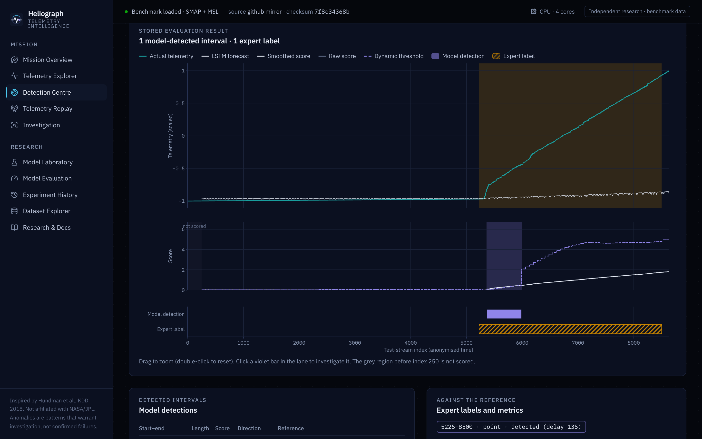

---

## Contents

1. [Quick start (Windows)](#quick-start-windows)
2. [Quick start (Linux / macOS)](#quick-start-linux--macos)
3. [What you can do](#what-you-can-do)
4. [Reference results](#reference-results)
5. [The data](#the-data)
6. [How it works](#how-it-works)
7. [Project structure](#project-structure)
8. [Testing](#testing)
9. [Reproducing the experiments](#reproducing-the-experiments)
10. [Deployment (browser demo / Docker)](#deployment-browser-demo--docker)
11. [Configuration](#configuration)
12. [Troubleshooting](#troubleshooting)
13. [Project status and verification](#project-status-and-verification)
14. [Limitations, references and licence](#limitations-references-and-licence)

---

## Quick start (Windows)

**Prerequisites**

* Windows 10 or 11
* **Python 3.12** (3.11–3.13, 64-bit) from <https://www.python.org/downloads/>, with "Add python.exe to PATH" ticked
* **Node.js 18+ LTS** from <https://nodejs.org/>
* About 4 GB of free disk space (PyTorch is the largest dependency) and an internet connection for setup

Open **PowerShell** in the project folder. If scripts are blocked, run this once:

```powershell
Set-ExecutionPolicy -Scope CurrentUser RemoteSigned
```

**1. Set up** (creates `backend\.venv`, installs dependencies, builds the UI, downloads and verifies the NASA dataset):

```powershell
.\setup.ps1 -DownloadData
```

If you have an NVIDIA GPU and want CUDA acceleration, run this instead:

```powershell
.\setup.ps1 -DownloadData -Cuda
```

**2. Start** (opens the browser):

```powershell
.\start.ps1
```

| What | Address |
|---|---|
| Web application | <http://localhost:5173> |
| Backend API | <http://localhost:8000> |
| Interactive API documentation | <http://localhost:8000/docs> |

**3. Stop:**

```powershell
.\stop.ps1
```

Nothing trains automatically. On first start, the database imports the **reference results** shipped in
`reference/`, so every page shows genuine results right away (marked **Reference**). Your own runs are
marked **Local**. CPU works everywhere. CUDA is used only if it is available, and you can force CPU with
`.\start.ps1 -Device cpu`.

---

## Quick start (Linux / macOS)

Prerequisites: Python 3.11–3.13, Node.js 18+, `curl`, about 3 GB of free disk space. From the project folder:

```bash
./setup.sh            # venv + CPU PyTorch, UI build, NASA dataset download, database (add --cuda for an NVIDIA GPU)
./start.sh            # backend on http://localhost:8000, UI on http://localhost:5173 — Ctrl+C stops both
```

`./start.sh --single` runs one process instead: FastAPI serves both the API and the built UI on
<http://localhost:8000> (API documentation then lives at `/api/docs`). `./start.sh --dev` starts the UI with
hot reload. Ports can be changed with `API_PORT=... UI_PORT=... ./start.sh`.

---

## What you can do

| Page | Purpose |
|---|---|
| **Mission Overview** | SMAP and Curiosity summaries, dataset status, analysed channels, detected intervals, latest result per method, and a per-channel map of detections vs labels |
| **Telemetry Explorer** | Browse training and test telemetry for any channel, zoom, overlay expert labels, and compare value distributions inside vs outside labelled regions |
| **Detection Centre** | Actual vs predicted telemetry, raw and smoothed score, dynamic threshold, detected intervals and expert labels on one shared axis (the Trace Stack); re-run the stored model live with different threshold settings |
| **Telemetry Replay** | Historical replay that reveals a test stream point by point while the model runs on each new point; start, pause, resume, reset and speed controls. **Not a live spacecraft link.** |
| **Investigation** | Every detected interval ranked by score: indices, values, prediction, score, threshold window, matching label and model |
| **Model Laboratory** | Configure and train any method on chosen channels (Quick / Standard / Paper profiles), watch live training and validation loss, cancel jobs |
| **Model Evaluation** | Event-wise and point-wise metrics, PR and ROC curves, confusion matrix, SMAP vs MSL, detection delay and IoU, per-channel table, timings |
| **Experiment History** | All runs with configuration, seed, code commit, dataset checksum and metrics; compare, export (JSON/CSV) and delete |
| **Dataset Explorer** | Provenance, checksums, validation report, SMAP and MSL breakdown, split lengths, label shares, channel inventory, data-quality warnings |
| **Research & Docs** | Background, LSTM explanation, dataset documentation, architecture, thresholding, evaluation, limitations, reproducibility and references |


### Screenshots

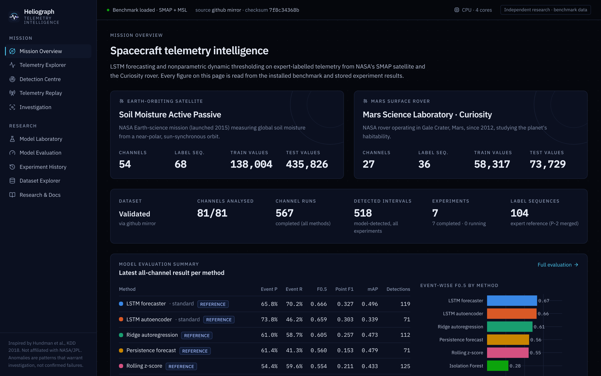
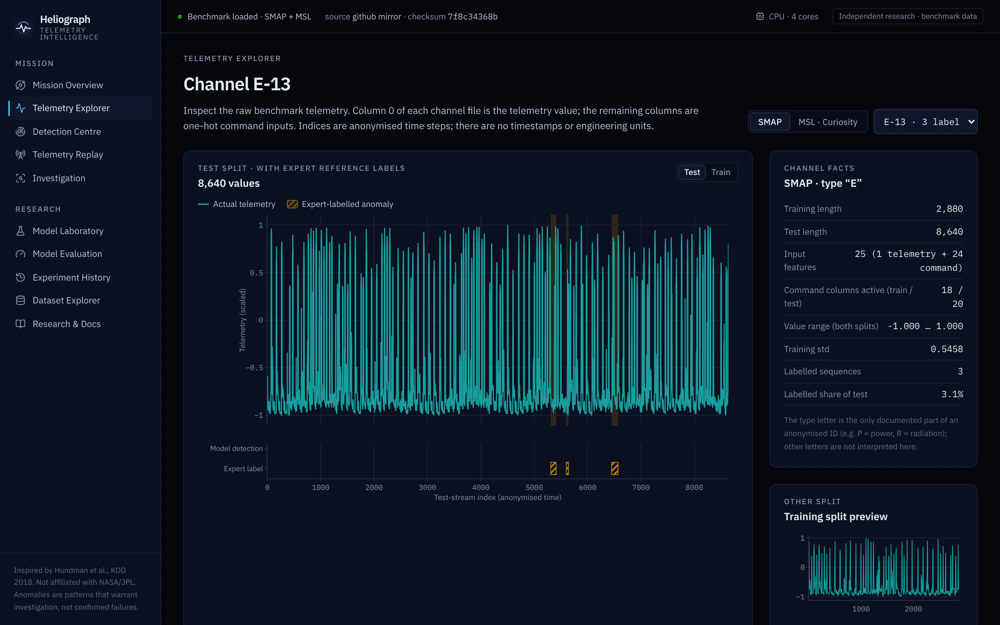
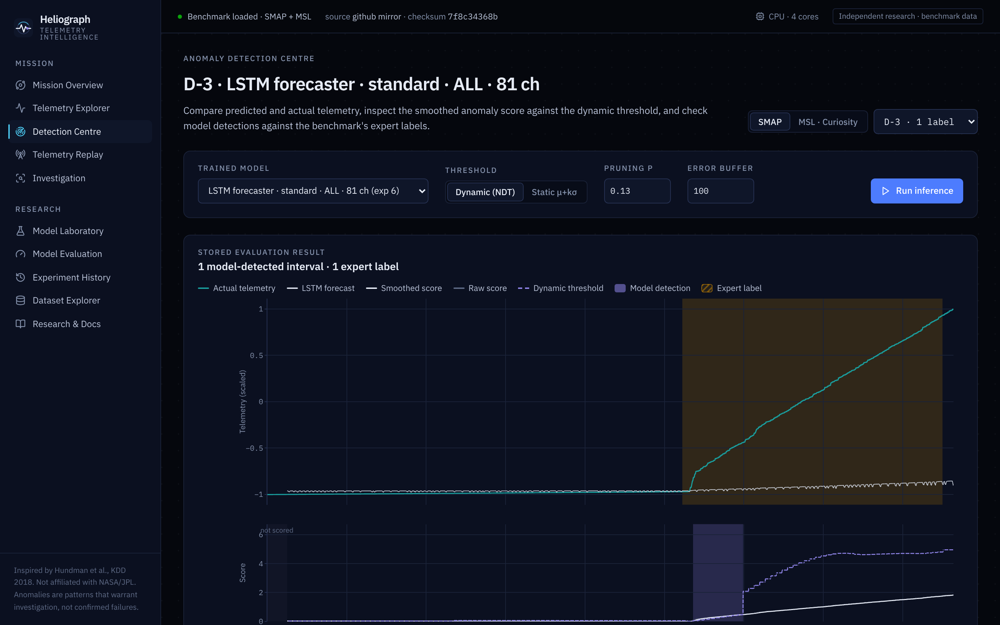
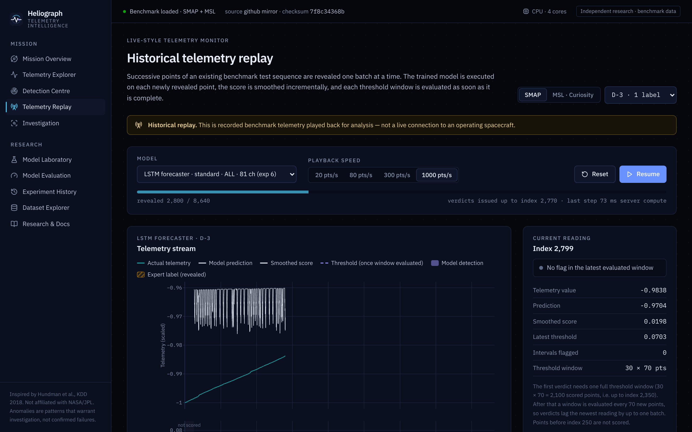
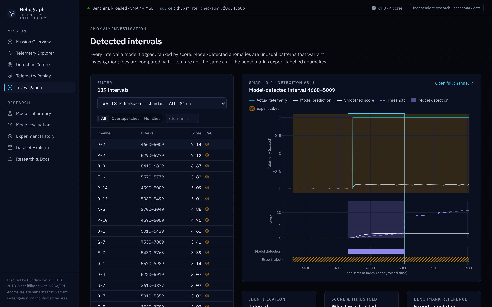
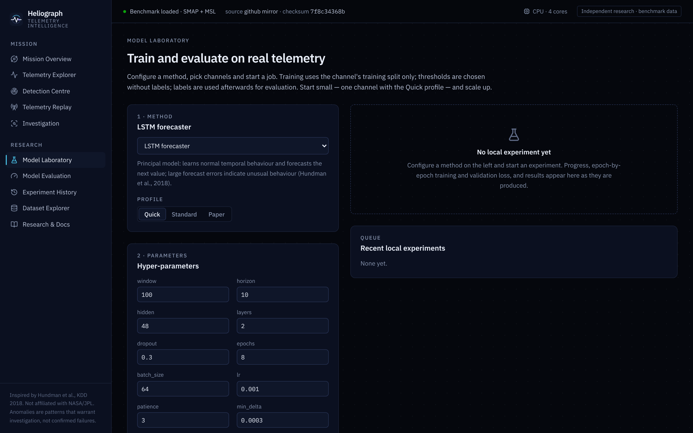
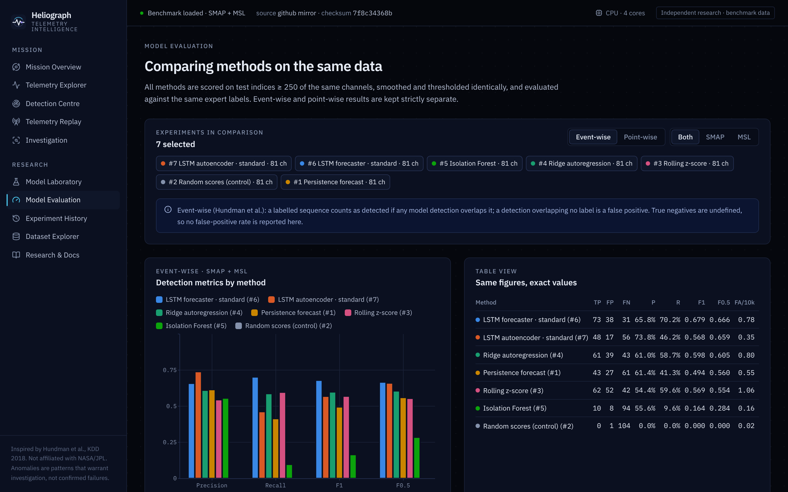
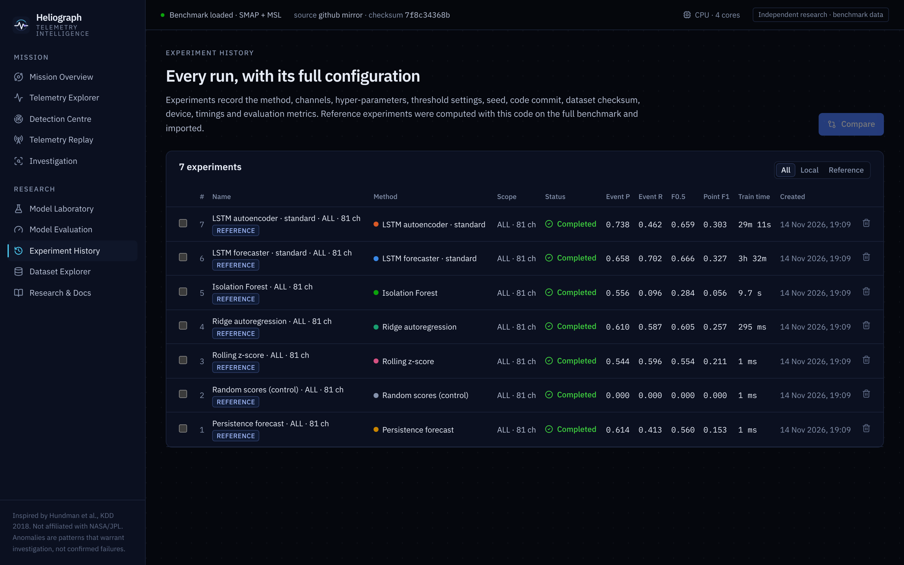
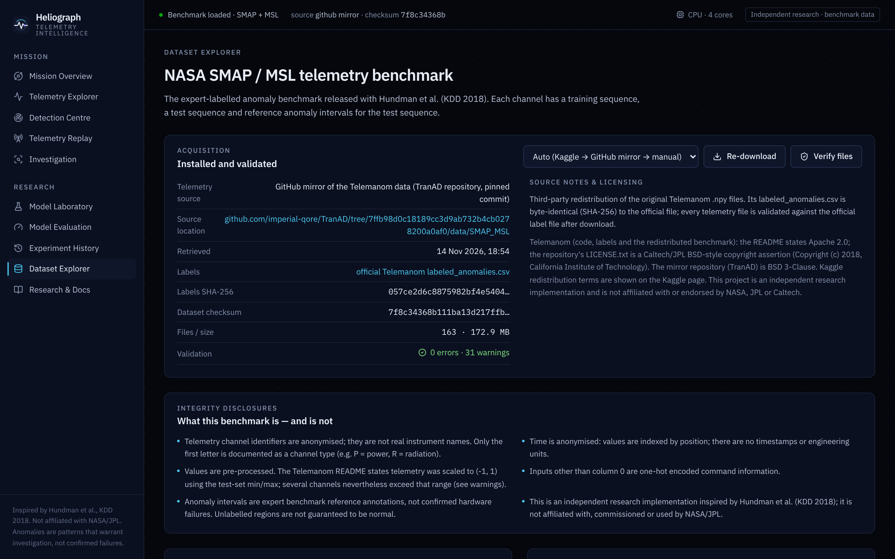
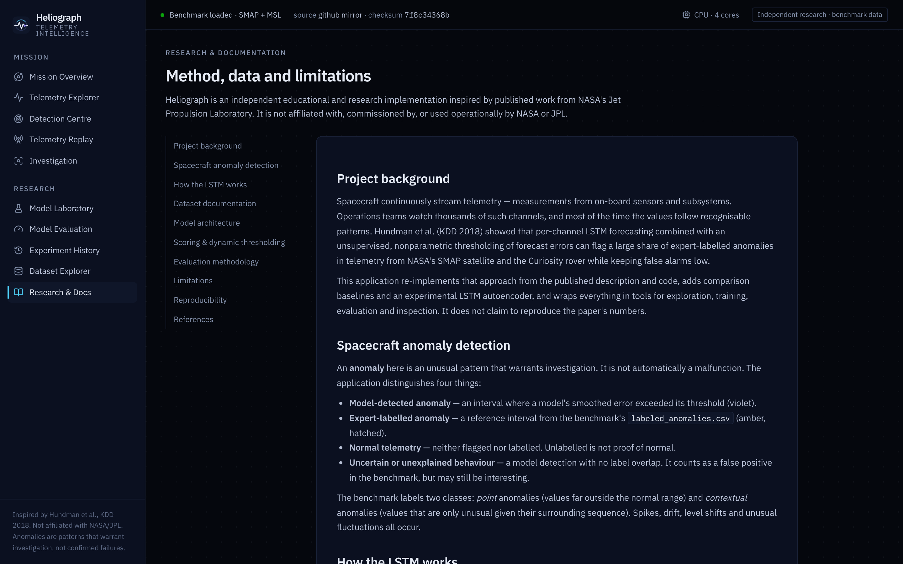

---

## Reference results

<!-- RESULTS:START -->
Computed by this application on **all 81 channels** (test indices ≥ 250, 489,305 evaluated points;
104 labelled sequences), seed 0, code commit `8a21ef9`, on Linux-6.18.44-fc-v470-x86_64-with-glibc2.39 CPU
(4 cores, PyTorch 2.15.0+cu132), 3 worker processes.
These are the experiments shipped in `reference/` and shown as **Reference** in the app. The table is generated by
`scripts/results_table.py` from the database, not typed by hand.

| Method | Event P | Event R | Event F0.5 | Event TP / FP / FN | Point P | Point R | Point F1 | Point FPR | mean AP | Training time (sum over channels) |
|---|---|---|---|---|---|---|---|---|---|---|
| LSTM forecaster (standard) | 65.8% | 70.2% | 0.666 | 73 / 38 / 31 | 52.4% | 23.8% | 0.327 | 3.2% | 0.496 | 3.54 h |
| LSTM autoencoder (standard) | 73.8% | 46.2% | 0.659 | 48 / 17 / 56 | 59.0% | 20.4% | 0.303 | 2.1% | 0.339 | 29.2 min |
| Ridge autoregression | 61.0% | 58.7% | 0.605 | 61 / 39 / 43 | 47.9% | 17.5% | 0.257 | 2.9% | 0.473 | 0.3 s |
| Persistence forecast | 61.4% | 41.3% | 0.560 | 43 / 27 / 61 | 42.4% | 9.4% | 0.153 | 1.9% | 0.479 | 0.0 s |
| Rolling z-score | 54.4% | 59.6% | 0.554 | 62 / 52 / 42 | 38.3% | 14.5% | 0.211 | 3.5% | 0.433 | 0.0 s |
| Isolation Forest | 55.6% | 9.6% | 0.284 | 10 / 8 / 94 | 42.2% | 3.0% | 0.056 | 0.6% | 0.328 | 9.7 s |
| Random scores (control) | 0.0% | 0.0% | 0.000 | 0 / 1 / 104 | 0.0% | 0.0% | 0.000 | 0.0% | 0.123 | 0.0 s |

| Method | SMAP event F0.5 | MSL event F0.5 | SMAP point F1 | MSL point F1 | point-anomaly recall | contextual recall |
|---|---|---|---|---|---|---|
| LSTM forecaster | 0.681 | 0.625 | 0.326 | 0.333 | 75.4% | 62.8% |
| LSTM autoencoder | 0.712 | 0.529 | 0.315 | 0.232 | 57.4% | 30.2% |
| Ridge autoregression | 0.597 | 0.625 | 0.241 | 0.341 | 72.1% | 39.5% |
| Persistence forecast | 0.570 | 0.536 | 0.143 | 0.212 | 50.8% | 27.9% |
| Rolling z-score | 0.583 | 0.464 | 0.216 | 0.181 | 80.3% | 30.2% |
| Isolation Forest | 0.282 | 0.288 | 0.053 | 0.077 | 13.1% | 4.7% |
| Random scores (control) | — | 0.000 | — | 0.000 | 0.0% | 0.0% |

"mean AP" is the average precision of the smoothed score computed per channel and averaged over the 81 channels.
Threshold-free, pooled over channels (each channel's smoothed score standardised): average precision —
LSTM forecaster 0.414, Ridge AR 0.382, LSTM autoencoder 0.289, rolling z-score 0.268, persistence 0.265,
Isolation Forest 0.239, random control 0.119 (the labelled share of evaluated points is 0.130); ROC AUC —
Ridge AR 0.716, LSTM forecaster 0.706, LSTM autoencoder 0.608, rolling z-score 0.598, Isolation Forest 0.591,
persistence 0.550, random control 0.470.

Event F0.5 with 95 % channel-bootstrap intervals (81 channels resampled with replacement, 10,000 draws, seed 0; differences are paired against LSTM forecaster):

| Method | Event F0.5 [95 % CI] | LSTM forecaster minus method [95 % CI] |
|---|---|---|
| LSTM forecaster | 0.666 [0.595, 0.740] | — |
| LSTM autoencoder | 0.659 [0.568, 0.743] | +0.007 [-0.089, +0.108] |
| Ridge autoregression | 0.605 [0.516, 0.697] | +0.061 [-0.035, +0.158] |
| Persistence forecast | 0.560 [0.464, 0.659] | +0.106 [+0.020, +0.195] |
| Rolling z-score | 0.554 [0.467, 0.642] | +0.112 [+0.034, +0.190] |
| Isolation Forest | 0.284 [0.138, 0.415] | +0.382 [+0.223, +0.557] |
| Random scores (control) | 0.000 [0.000, 0.000] | +0.666 [+0.595, +0.740] |

**Reading these results**

* The **LSTM forecaster** has the highest event-wise F0.5 and the best recall on *contextual* anomalies,
  which is where a non-linear temporal model should help most. It does **not** win everywhere: Ridge
  autoregression matches it on MSL event F0.5 and slightly exceeds it on pooled ROC AUC.
* **The ranking at the top is not statistically settled.** With only 104 labelled sequences the bootstrap
  intervals above are about ±0.07–0.10 wide. The LSTM forecaster's lead over the LSTM autoencoder (+0.007) and
  over Ridge autoregression (+0.061) is inside that noise (both paired intervals include 0); only its margins
  over persistence, rolling z-score, Isolation Forest and the random control exclude 0. All figures come from a
  single seed (0); seed-to-seed variation of the neural models was not measured.
* The **LSTM autoencoder** is the most precise but misses more sequences (low recall).
* The **random control** produces a single detection over 81 channels: the thresholding does not inflate scores.
* Point-wise recall is low for every method. Many labelled intervals are long, and the dynamic threshold
  flags mainly the onset of sustained anomalies (see [docs/limitations.md](docs/limitations.md)).
* 36 of 81 channels are event-wise perfect for the LSTM. Hard cases include `G-7` (5 false alarms) and
  `F-1`, `F-4`, `M-5` (label missed).
* For context only: Hundman et al. report 87.5 % precision and 80.0 % recall. That figure is not directly
  comparable (different training profile, early stopping, thresholding details and `P-2` handling).
<!-- RESULTS:END -->

---

## The data

The **NASA SMAP / MSL telemetry anomaly benchmark** (Telemanom):

* 81 unique channels: 54 SMAP and 27 MSL. The label file has 82 rows because `P-2` is listed twice; this project merges the two rows.
* 105 labelled anomaly sequences in the file (104 after merging `P-2`): 62 point and 43 contextual.
* 25 input features per timestep for SMAP and 55 for MSL. Column 0 is telemetry; the rest are one-hot command inputs.
* Anonymised channel IDs, anonymised time, pre-processed values. There are no timestamps or engineering units.

Acquisition tries, in order: **Kaggle** (the source named in the Telemanom README), a **pinned GitHub copy**
of the original Telemanom files, and a manually supplied `data.zip`. The label file always comes from the
official Telemanom repository and is checked by SHA-256. Every file is validated against it before
installation. Full details, measured statistics and the integrity disclosures are in
[docs/dataset.md](docs/dataset.md).

---

## How it works

```
train split ──► fit model (LSTM forecaster | LSTM autoencoder | baselines) ──► saved checkpoint
test split  ──► causal raw scores (forecast / reconstruction error) ──► EWMA smoothing
            ──► nonparametric dynamic thresholding (windows of 30×70, z-search, inverse pass, pruning)
            ──► detected intervals ──► compared with expert labels (event-wise, point-wise, delay, IoU)
```

* Models never see test data or labels during training, and thresholds use no labels. Automated tests enforce both.
* Every method is scored on test indices ≥ 250 and goes through the same smoothing, thresholding and evaluation.
* Event-wise and point-wise metrics are always reported separately, with no point adjustment.
* Deviations from the original Telemanom code are deliberate and documented.

Read more: [docs/methodology.md](docs/methodology.md) · [docs/architecture.md](docs/architecture.md) ·
[docs/limitations.md](docs/limitations.md)

**Stack:** FastAPI · Pydantic · SQLAlchemy + Alembic · SQLite (WAL) · PyTorch · NumPy · pandas · SciPy ·
scikit-learn · React 18 · TypeScript · Vite · Tailwind CSS 4 · Plotly.js · TanStack Query · Pytest ·
Vitest · Playwright.

---

## Project structure

```
Spacecraft/
├── setup.ps1 / start.ps1 / stop.ps1     Windows setup, start and stop
├── setup.sh / start.sh                  Linux / macOS setup and start
├── deploy/huggingface/                  Dockerfile, Space card and publish.py (upload to a Hugging Face Space)
├── backend/
│   ├── app/
│   │   ├── api/          FastAPI routers (system, dataset, experiments, analysis)
│   │   ├── services/     jobs (worker processes), inference, replay, evaluation, experiments, reference bundle
│   │   ├── ml/           models (LSTM, autoencoder, baselines), training, scoring (EWMA, NDT), evaluation, pipeline
│   │   ├── dataset/      sources, acquisition, validation, label parsing, data access
│   │   ├── db/           SQLAlchemy models and session (SQLite, WAL)
│   │   └── core/         settings
│   ├── alembic/          database migrations
│   └── tests/            unit + integration tests (pytest)
├── frontend/
│   ├── src/pages/        the ten application pages
│   ├── src/components/   Trace Stack, Plot wrapper, UI kit, pickers
│   ├── src/test/         Vitest component tests
│   └── e2e/              Playwright end-to-end workflows
├── scripts/              acquire_data, init_db, run_reference, export_reference, results_table
├── reference/            committed reference results (metrics, detections, checkpoints, arrays)
├── docs/                 dataset, methodology, architecture, limitations, references
├── data/                 (not in git) raw benchmark, SQLite database
└── artifacts/            (not in git) models and arrays from your local experiments
```

---

## Testing

Run these from the project root after setup. Backend unit and integration tests (the integration tests use
the real dataset and a throwaway database):

```powershell
cd backend; .\.venv\Scripts\python -m pytest; cd ..
```

On Linux / macOS: `cd backend && .venv/bin/python -m pytest`.

Frontend component tests:

```powershell
cd frontend; npm test; cd ..
```

End-to-end browser workflows (start an isolated backend on :8001 and UI on :5174, train a small real model,
then test inference, replay, history and evaluation):

```powershell
cd frontend; npx playwright install chromium; npm run e2e -- --trace off; cd ..
```

---

## Reproducing the experiments

```powershell
backend\.venv\Scripts\python scripts\run_reference.py --workers 2
backend\.venv\Scripts\python scripts\results_table.py
```

`run_reference.py` queues the same seven experiments as the shipped reference run (all 81 channels) through
the application's own job system. Every experiment stores its configuration, seed, code commit, dataset
checksum, device and timings. The LSTM steps take hours on a laptop CPU. Exact numbers can differ slightly
across platforms and PyTorch builds.

---

## Deployment (browser demo / Docker)

**Browser demo.** The [live demo](https://huggingface.co/spaces/agrawalaarush08/heliograph) is a static page built
by `deploy/browser/build.py`. It shows the stored reference results from `reference/` (benchmark scores, and for
every channel and method the model forecast, smoothed error, dynamic thresholds, detected intervals and expert
labels). It trains and computes nothing; the telemetry is not copied into it but downloaded in the browser from the
same pinned public GitHub copy of the benchmark that setup uses. Static Spaces are free:

```bash
backend/.venv/bin/python deploy/browser/build.py --out build/browser-demo
pip install huggingface_hub && hf auth login
backend/.venv/bin/python deploy/browser/build.py --out build/browser-demo --space <your-username>/heliograph
```

**Full app in Docker.** `deploy/huggingface/Dockerfile` builds one CPU container in which FastAPI serves the API and the built UI on
port 7860. The image downloads and verifies the benchmark and imports the reference results at build time.

Run it locally (from the project root, with Docker installed):

```bash
docker build -f deploy/huggingface/Dockerfile -t heliograph .
docker run --rm -p 7860:7860 heliograph      # then open http://localhost:7860  (API docs: /api/docs)
```

To publish the full app as a Hugging Face Docker Space, use the upload script (it needs a Hugging Face account and a
token with **write** permission from <https://huggingface.co/settings/tokens>). Hugging Face currently requires a
PRO subscription to run Docker Spaces, even on the basic CPU hardware; without one, creating the Space fails with
HTTP 402.

```bash
pip install huggingface_hub
hf auth login                                                    # paste the write token
python deploy/huggingface/publish.py --space <your-username>/heliograph --dry-run   # check what will be sent
python deploy/huggingface/publish.py --space <your-username>/heliograph
```

The script creates the Space (Docker SDK, basic CPU) if needed, puts `deploy/huggingface/Dockerfile` and
`deploy/huggingface/README.md` (the Space card) at its root, and uploads the project. Use it instead of a plain
`git push` to the Space: the repository contains about 800 binary files (checkpoints, arrays, screenshots) and the
Hub rejects binary files pushed with git unless they are stored in Git LFS / Xet; the upload API handles that for
you. The first build takes about 10-15 minutes. A CPU Space restarts when idle, so experiments trained there are not
kept; the reference results are always available.

---

## Configuration

Environment variables (all optional):

| Variable | Default | Meaning |
|---|---|---|
| `HELIOGRAPH_DEVICE` | `auto` | `auto`, `cpu` or `cuda` (also `start.ps1 -Device`) |
| `HELIOGRAPH_TORCH_THREADS` | min(2, CPU cores ÷ workers) | CPU threads per training process. Small LSTMs gain little from more threads, and a higher value can stall training on a busy machine |
| `HELIOGRAPH_MAX_CONCURRENT_JOBS` | `1` | experiments running at the same time |
| `HELIOGRAPH_DATA_DIR` / `HELIOGRAPH_DB_PATH` / `HELIOGRAPH_ARTIFACTS_DIR` | project folders | storage locations |
| `KAGGLE_USERNAME` / `KAGGLE_KEY` | — | optional Kaggle credentials for the download |

For low-memory laptops, use the **Quick** profile and a few channels per experiment, with one worker process.

---

## Troubleshooting

| Problem | Fix |
|---|---|
| "running scripts is disabled" | `Set-ExecutionPolicy -Scope CurrentUser RemoteSigned` |
| "Port 8000/5173 is already in use" | Run `.\stop.ps1` (Linux/macOS: press Ctrl+C in the terminal running `./start.sh`), close the other program using the port, or pick other ports with `API_PORT=... UI_PORT=... ./start.sh` |
| Kaggle download fails | Setup falls back to the GitHub copy automatically. Or download the zip from the Kaggle page, save it as `data\incoming\data.zip`, then run `backend\.venv\Scripts\python scripts\acquire_data.py --source manual` (Linux/macOS: `data/incoming/data.zip` and `backend/.venv/bin/python scripts/acquire_data.py --source manual`) |
| UI shows "Backend unreachable" | Check `logs\backend.err.log`, then restart with `.\stop.ps1` and `.\start.ps1` (Linux/macOS: check `logs/backend.err.log`, press Ctrl+C and run `./start.sh` again) |
| Project in OneDrive | Move it outside OneDrive; syncing can lock the database |
| CUDA not used | Run `.\setup.ps1 -Cuda` (needs an NVIDIA driver); check the CPU/CUDA badge in the top bar |

---

## Project status and verification

What has been checked, and how. Everything below was run on Linux (4 CPU cores, no GPU).

| Area | How it was verified |
|---|---|
| Real SMAP and MSL data | 81 channels / 162 telemetry files installed and recorded in a SHA-256 manifest; the counts reproduce the Telemanom README (429,735 / 66,709 evaluated values) |
| Anomaly labels | Unit tests for parsing and merging; every test length equals `num_values`; 105 → 104 sequences after merging `P-2` (see [docs/dataset.md](docs/dataset.md)) |
| LSTM training | Reference run: 81/81 channels trained (3.54 h of CPU time in total); a Quick LSTM is trained through the UI in an end-to-end test |
| Predictions and scores | Live inference from a bundled checkpoint reproduces the stored predictions exactly (max difference 0.0); scores are the absolute forecast/reconstruction errors of the trained models, and label-leakage tests pass |
| Thresholding | 11 unit tests (spike detection, inverse pass, scale guard, pruning, exact zone tiling, streaming = offline) |
| Inspection and comparison with labels | Investigation page and API detail endpoint; per-label detected/missed, delay and IoU; event-wise and point-wise metrics, unit-tested against hand-computed cases |
| Dashboard and history | All overview figures come from SQL queries; experiment history survives a backend restart, including recovery of interrupted jobs |
| Automated tests | 68 pytest (48 unit, 20 integration on real data), 8 Vitest, 6 Playwright end-to-end workflows, all passing |
| Runtime errors | 567/567 reference channel runs succeeded; no browser console errors on any page |

**Notes on the reference results**

* The reference results were computed on the pinned GitHub copy of the dataset. Its label file is byte-identical to
  the official one and every file passed validation. Setup tries Kaggle first.
* The reference LSTM uses the **standard** profile (64 units, ≤ 20 epochs) rather than the full paper profile, to
  keep CPU time reasonable. The paper profile is available in the laboratory.

**Windows.** The Windows scripts (`setup.ps1`, `start.ps1`, `stop.ps1`) target Windows PowerShell 5.1 and parse
without errors in PowerShell 7.4, but they have not yet been run on a Windows machine. To check them (about
10 minutes plus downloads):

1. `.\setup.ps1 -DownloadData` ends with "Setup complete".
2. `.\start.ps1` opens <http://localhost:5173>, and the top bar shows "Benchmark loaded".
3. In the Model Laboratory, train the LSTM forecaster with the Quick profile on one channel, then open it in the Detection Centre.
4. `.\stop.ps1` reports "Heliograph stopped".

---

## Limitations, references and licence

* Limitations and interpretation: [docs/limitations.md](docs/limitations.md)
* References: [docs/references.md](docs/references.md)
* Code licence: [MIT](LICENSE).
* Dataset licensing: Telemanom (Caltech/JPL copyright; README states Apache 2.0); the mirror used is BSD 3-Clause.
  The telemetry is not stored in this repository; it is downloaded during setup.
